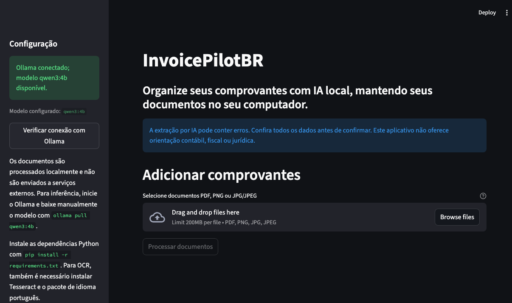

# InvoicePilotBR

Organize comprovantes e documentos de despesas com extração por IA local. O InvoicePilotBR é voltado principalmente a **notas fiscais, invoices, recibos e comprovantes de despesas brasileiros**, considerando formatos e convenções locais, como valores em BRL e documentos em português. Foi pensado para freelancers, profissionais independentes e MEIs; não substitui orientação contábil, fiscal ou jurídica.

> **Atenção:** os resultados da IA podem estar incorretos ou incompletos. Revise cada registro e marque explicitamente as linhas confirmadas antes de exportar.

## Captura da interface



## Como executar o projeto

Após instalar os requisitos e dependências descritos abaixo, abra dois terminais na pasta do projeto:

1. Inicie o Ollama (se ele ainda não estiver em execução):

   ```bash
   ollama serve
   ```

2. No outro terminal, ative o ambiente virtual, configure o modelo e inicie a interface:

   ```bash
   source .venv/bin/activate
   ollama pull qwen3:4b
   cp .env.example .env  # somente na primeira execução
   streamlit run app.py
   ```

   O comando `ollama pull` baixa o modelo manualmente e só precisa ser executado uma vez. Edite `.env` para ajustar o modelo, os limites de upload ou o tempo máximo de inferência.

3. Abra no navegador o endereço local exibido pelo Streamlit (normalmente <http://localhost:8501>).

Para executar os testes automatizados:

```bash
source .venv/bin/activate
pytest
```

## Recursos

- Upload em lote de arquivos PDF, PNG e JPG/JPEG, com validação de assinatura e limite de tamanho.
- Extração de texto de PDFs digitais com PyMuPDF e OCR de imagens/PDFs digitalizados com Tesseract.
- Extração estruturada com Ollama local (modelo padrão `qwen3:4b`).
- Revisão e edição dos dados; totais consideram apenas registros incluídos e confirmados.
- Exportação CSV UTF-8 com `;`, adequada a planilhas configuradas para localidades brasileiras.
- Documentos mantidos em memória durante o processamento; não são persistidos pelo aplicativo.

## Arquitetura

- `app.py`: interface Streamlit, revisão manual, totais e download.
- `src/document_reader.py`: validação e extração PDF/OCR, sem salvar os documentos.
- `src/ai_extractor.py`: chamadas de inferência exclusivamente ao Ollama local.
- `src/models.py` e `src/validator.py`: modelo Pydantic e validação/normalização.
- `src/exporter.py`: CSV com proteção contra injeção de fórmulas.
- `tests/`: testes sintéticos; não exigem Ollama em execução nem acesso à internet.

## Requisitos

- Python 3.11 ou mais recente.
- Ollama instalado e em execução para extração por IA.
- Tesseract com dados de idioma `por` para processar imagens e PDFs digitalizados.
- O modelo `qwen3:4b` baixado manualmente (não é baixado pelo aplicativo).

### Instalação no macOS

Instale Python, Tesseract e Ollama. Com Homebrew:

```bash
brew install python tesseract
brew install ollama
```

Instale o pacote de idioma português do Tesseract se não estiver presente no pacote do sistema. No Homebrew, os dados ficam normalmente em `$(brew --prefix)/share/tessdata`. Para instalar o arquivo oficial de dados do português nesse diretório:

```bash
curl -L https://raw.githubusercontent.com/tesseract-ocr/tessdata/main/por.traineddata \
  -o "$(brew --prefix)/share/tessdata/por.traineddata"
tesseract --list-langs
```

Confirme que `por` aparece na lista. O programa informa quando o executável ou o idioma configurado não estiver disponível.

Inicie o Ollama em uma janela de terminal:

```bash
ollama serve
```

Em outra janela, baixe o modelo manualmente:

```bash
ollama pull qwen3:4b
```

Crie ambiente virtual e instale as dependências Python:

```bash
cd "/caminho/para/invoicepilot-br"
python3 -m venv .venv
source .venv/bin/activate
python -m pip install --upgrade pip
pip install -r requirements.txt
cp .env.example .env
```

Edite `.env` quando necessário:

```dotenv
OLLAMA_BASE_URL=http://localhost:11434
OLLAMA_MODEL=qwen3:4b
DEFAULT_CURRENCY=BRL
MAX_FILE_SIZE_MB=15
MAX_FILES_PER_BATCH=20
OCR_LANGUAGE=por
OLLAMA_TIMEOUT_SECONDS=300
```

Se a inferência demorar, o app mostrará um indicador enquanto o modelo local processa o texto. Se atingir o tempo limite, verifique se o Ollama continua ativo com `ollama ps`; em computadores mais lentos, aumente `OLLAMA_TIMEOUT_SECONDS` no `.env` e reinicie o Streamlit.

Execute a aplicação:

```bash
streamlit run app.py
```

Execute os testes sintéticos:

```bash
pytest
```

## CSV

O arquivo exportado usa codificação UTF-8, delimitador ponto e vírgula e estas colunas: `arquivo_origem`, `fornecedor`, `data`, `valor`, `moeda`, `categoria` e `descricao`. Datas usam ISO (`AAAA-MM-DD`) e valores usam ponto decimal sem separador de milhar, por exemplo `125.90`. Campos de texto potencialmente interpretados como fórmulas por planilhas recebem apóstrofo inicial; valores monetários permanecem numéricos. Apenas registros incluídos e explicitamente confirmados pelo usuário são exportados.

## Privacidade e limitações

O código envia ao Ollama apenas o texto extraído e usa como endpoint padrão `http://localhost:11434`. `OLLAMA_BASE_URL` aceita somente loopback (`localhost`, `127.0.0.1` ou `::1`) para impedir configuração acidental de inferência remota; não há API paga, telemetria ou analytics. O próprio texto do documento é tratado como entrada não confiável. Ainda assim, o usuário é responsável por proteger seu computador, a instalação local do Ollama, seus arquivos e o ambiente onde executa o programa. O app não armazena documentos de forma persistente por padrão.

OCR depende do Tesseract e do idioma configurado. Qualidade de digitalização, layout e desempenho do modelo podem afetar os resultados. A aplicação não verifica conformidade legal, fiscal ou contábil e não substitui a análise humana.

## Licenças

Este projeto é distribuído sob a licença MIT. As bibliotecas Python têm licenças próprias. Pesos e termos de uso do modelo Qwen3 são independentes da licença deste repositório; consulte os termos publicados pelo fornecedor do modelo antes de usar ou redistribuir os pesos.

## Contribuições

Contribuições são bem-vindas. Abra uma issue para discutir mudanças maiores, envie uma pull request com testes sintéticos e evite incluir comprovantes reais, dados pessoais, credenciais ou arquivos `.env`. Mantenha o processamento local e não adicione serviços de inferência externos sem uma discussão explícita.

---

# English

Organize expense documents with local AI. InvoicePilotBR is primarily intended for **Brazilian invoices, receipts, and expense documents**, with local conventions in mind, such as BRL amounts and Portuguese-language documents. It is designed for Brazilian freelancers, independent professionals, and MEIs (Brazilian individual micro-entrepreneurs). It does not provide accounting, tax, or legal advice.

> **Important:** AI extraction may be incorrect or incomplete. Review every record and explicitly mark it as confirmed before exporting.

## Application screenshot


## Features

- Batch upload of PDF, PNG, and JPG/JPEG files, with signature validation and configurable size limits.
- Text extraction from digital PDFs with PyMuPDF and OCR for images/scanned PDFs with Tesseract.
- Structured extraction using local Ollama (default model: `qwen3:4b`).
- Editable review table; totals include only records that are included and confirmed.
- UTF-8 CSV export using `;`, suitable for spreadsheet locales commonly used in Brazil.
- Documents remain in memory during processing and are not persisted by the application.

## Architecture

- `app.py`: Streamlit UI, manual review, totals, and downloads.
- `src/document_reader.py`: PDF/OCR validation and text extraction without saving documents.
- `src/ai_extractor.py`: inference exclusively through local Ollama.
- `src/models.py` and `src/validator.py`: Pydantic model and data validation/normalization.
- `src/exporter.py`: CSV export with formula-injection protection.
- `tests/`: synthetic tests that do not require a running Ollama instance or internet access.

## Requirements

- Python 3.11 or newer.
- Ollama installed and running for AI extraction.
- Tesseract with Portuguese (`por`) language data for images and scanned PDFs.
- The `qwen3:4b` model downloaded manually; the application does not download models.

## How to run the project

### 1. Install system requirements on macOS

Install Python, Tesseract, and Ollama using Homebrew:

```bash
brew install python tesseract ollama
```

If the Tesseract Portuguese language data is not already installed, install it and verify that `por` is listed:

```bash
curl -L https://raw.githubusercontent.com/tesseract-ocr/tessdata/main/por.traineddata \
  -o "$(brew --prefix)/share/tessdata/por.traineddata"
tesseract --list-langs
```

### 2. Create a Python environment and install dependencies

From the project directory:

```bash
python3 -m venv .venv
source .venv/bin/activate
python -m pip install --upgrade pip
pip install -r requirements.txt
cp .env.example .env
```

Edit `.env` if you want to change the local endpoint, model, currency, upload limits, or maximum inference time:

```dotenv
OLLAMA_BASE_URL=http://localhost:11434
OLLAMA_MODEL=qwen3:4b
DEFAULT_CURRENCY=BRL
MAX_FILE_SIZE_MB=15
MAX_FILES_PER_BATCH=20
OCR_LANGUAGE=por
OLLAMA_TIMEOUT_SECONDS=300
```

Inference speed depends on the model and computer. The app displays a spinner while Ollama works; if a request times out, check that Ollama is still active with `ollama ps`, increase `OLLAMA_TIMEOUT_SECONDS` in `.env` if needed, and restart Streamlit.

### 3. Start Ollama and download the model

In a separate terminal, start the local Ollama service:

```bash
ollama serve
```

Then, in another terminal, download the model manually (only needed once):

```bash
ollama pull qwen3:4b
```

### 4. Launch InvoicePilotBR

From the project directory, with the virtual environment activated:

```bash
streamlit run app.py
```

Open the local URL printed by Streamlit, usually <http://localhost:8501>.

### Run the tests

```bash
source .venv/bin/activate
pytest
```

## CSV export

The exported file uses UTF-8 encoding, a semicolon delimiter, and these Portuguese column names: `arquivo_origem`, `fornecedor`, `data`, `valor`, `moeda`, `categoria`, and `descricao`. Dates use ISO format (`YYYY-MM-DD`); amounts use a decimal point and no thousands separator, for example `125.90`. Text fields that could be interpreted as spreadsheet formulas are prefixed with an apostrophe; monetary values remain numeric. Only records explicitly included and confirmed by the user are exported.

## Privacy and limitations

The application sends only extracted text to Ollama at the default local endpoint, `http://localhost:11434`. `OLLAMA_BASE_URL` only accepts loopback addresses (`localhost`, `127.0.0.1`, or `::1`) to prevent accidentally configuring remote inference. There are no paid AI APIs, telemetry, or analytics. Document text is treated as untrusted input. Users are still responsible for securing their computer, local Ollama installation, documents, and runtime environment. The application does not persist uploaded documents by default.

OCR requires Tesseract and the configured language data. Scan quality, document layout, and model performance can affect extraction. The application does not verify legal, tax, or accounting compliance and does not replace human review.

## License

This project is distributed under the MIT License. Python libraries have their own licenses. Qwen3 model weights and terms of use are independent of this repository's MIT license; review the model provider's terms before using or redistributing those weights.

## Contributing

Contributions are welcome. Open an issue to discuss larger changes and submit pull requests with synthetic tests. Do not include real invoices or receipts, personal information, credentials, or `.env` files. Keep processing local and discuss any proposed external inference service before implementation.
